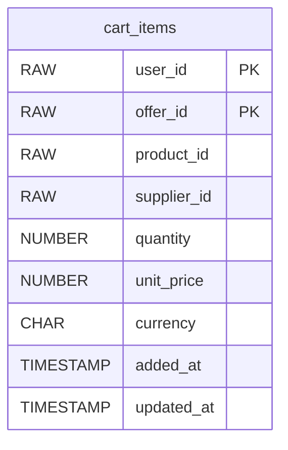

# ShopTrail Cart Service

Shopping carts for ShopTrail, priced from supplier offers and checked against stock.

Part of **ShopTrail**, a multi-seller marketplace. Full system reference: [`marketplace_tdd.md`](https://github.com/RaghuMHulkoti/shoptrail/blob/main/docs/marketplace_tdd.md).

| | |
|---|---|
| Live | https://cart-service-csoc.onrender.com |
| Swagger UI | https://cart-service-csoc.onrender.com/swagger-ui.html |
| Health | https://cart-service-csoc.onrender.com/actuator/health |
| Local port | `8084` |
| Database | Oracle Autonomous DB, schema `CART` (Flyway) |
| Stack | Java 25, Spring Boot 4.1, Spring Data JPA, Flyway |

## Responsibilities

- Add, change, remove and clear cart lines for a user.
- Price each line from the best active supplier offer and record the supplier.
- Check availability with inventory before adding.
- Merge a guest cart into a user's cart.
- Purge carts untouched for 30 days.

## How it fits

- REST out: product-service (product), supplier-service (offers), inventory-manager (availability).
- REST in: order-service reads the cart at checkout and removes ordered lines after confirmation.
- The user is identified by the `X-User-Id` header.

## Run locally

Prerequisites: JDK 25+, Maven wrapper (included), the Oracle wallet of the shared database.

```bash
export DB_PASSWORD=...                       # Oracle password (never commit it)
export WALLET_DIR=/path/to/Wallet_ECOMMERCE  # unzipped Oracle wallet
./mvnw spring-boot:run
```

Open http://localhost:8084/swagger-ui.html.

### Tests

```bash
./mvnw test
```

Tests run on H2 in Oracle mode with stubbed downstream services.

### Docker

```bash
docker build -t shoptrail-cart-service .
docker run -p 8084:8084 -e DB_PASSWORD=... -e WALLET_CWALLET_B64="$(base64 < cwallet.sso)" shoptrail-cart-service
```

`docker-entrypoint.sh` unpacks the wallet from `WALLET_CWALLET_B64` when it is set.

## Configuration

All settings come from environment variables. Secrets have no defaults and must never be committed.

| Variable | Default | Purpose |
|---|---|---|
| `WALLET_DIR` | a local path | Folder of the Oracle wallet (local runs). On Render set `WALLET_CWALLET_B64` instead |
| `DB_USERNAME` | `ADMIN` | Oracle user |
| `DB_PASSWORD` | _(none, secret)_ | Oracle password. Required, no default |
| `SERVER_PORT` | `8084` | HTTP port |
| `PRODUCT_SERVICE_URL` | `https://product-service-1o2l.onrender.com` | product-service base URL |
| `SUPPLIER_SERVICE_URL` | `https://supplier-service-tha0.onrender.com` | supplier-service base URL |
| `INVENTORY_SERVICE_URL` | `https://inventory-manager-8q64.onrender.com` | inventory-manager base URL |
| `OTEL_EXPORTER_OTLP_ENDPOINT` | `http://localhost:4318` | OTLP endpoint for metrics push (active only with `OTEL_METRICS_EXPORTER=otlp`) |
| `OTEL_SERVICE_NAME` | application name | `service.name` resource attribute |
| `CORS_ALLOWED_ORIGINS` | _(empty)_ | Comma-separated browser origins allowed to call the API. Empty = none. No trailing dot or slash |

## API

Responses are wrapped as `{"status", "message", "body"}`. Every call needs `X-User-Id`.

| Method | Path | Purpose |
|---|---|---|
| GET | `/api/v1/cart` | Current cart with prices |
| POST | `/api/v1/cart/items` | Add a product `{productId, quantity}` |
| PATCH | `/api/v1/cart/items/{itemId}` | Change quantity |
| DELETE | `/api/v1/cart/items/{itemId}` | Remove a line |
| DELETE | `/api/v1/cart` | Empty the cart |
| POST | `/api/v1/cart/merge` | Merge a guest cart into the user's cart |

## Data model

Schema `CART`. Full columns and constraints: [section 8 of the reference](https://github.com/RaghuMHulkoti/shoptrail/blob/main/docs/marketplace_tdd.md#8-data-model).



| Table | Holds | Created in |
|---|---|---|
| `cart_items` | One line per user and offer (one per product), with price and supplier | `V1__create_cart_schema.sql` |

## Events

None. Cart is synchronous only.

## Background jobs

| Job | Schedule | Does |
|---|---|---|
| `CartPurgeJob` | daily 03:30 (`cart.purge-cron`) | Deletes carts untouched for `cart.ttl` (30 days) |

## How it works

- The primary key `(user_id, offer_id)` and the unique `(user_id, product_id)` keep one line per product.
- Prices are captured when a line is added; order-service takes its own snapshot at checkout.
- Downstream calls use a 30-second read timeout (Render free instances can be cold).

## Deployment

- Render web service (Docker), deployed manually or with `render deploys create <service-id>`.
- Set at least: `DB_PASSWORD`, `WALLET_CWALLET_B64`, `CORS_ALLOWED_ORIGINS` (order console origin).
- CI: `.github/workflows/maven.yml` runs `mvn test`, builds the image, smoke-tests the container and pushes it to `ghcr.io`.
- Observability: `/actuator/health` (liveness and readiness probes), Prometheus at `/actuator/prometheus`, optional OTLP push.

## Known gaps

- Trusts `X-User-Id`; no JWT check yet.
- No price-change notice when an offer's price changes after adding.

## License

Copyright (c) 2026 Raghavendra. All rights reserved. The code is published for viewing only; copying or reuse requires written permission. See [LICENSE](LICENSE).
